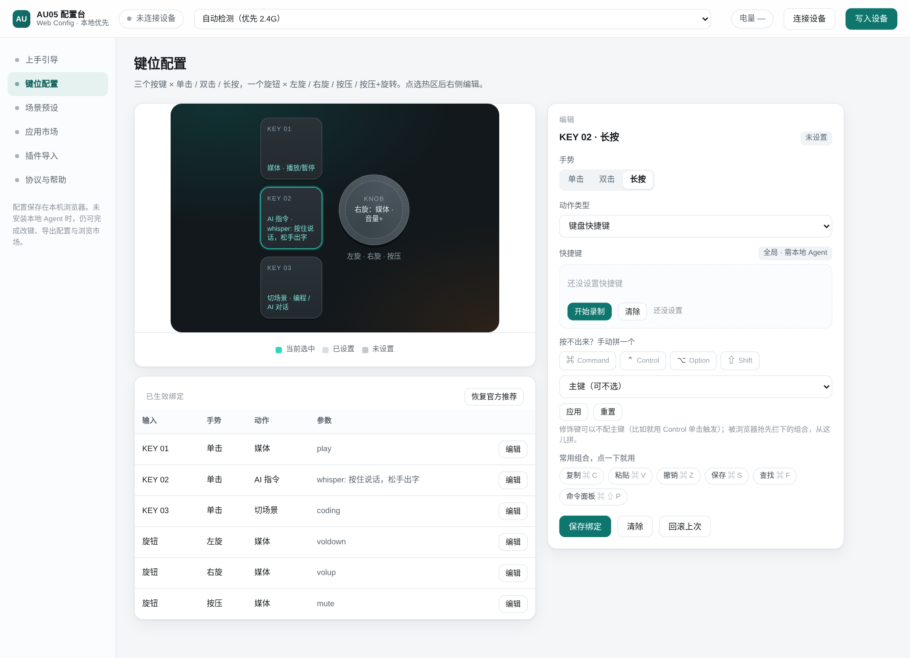
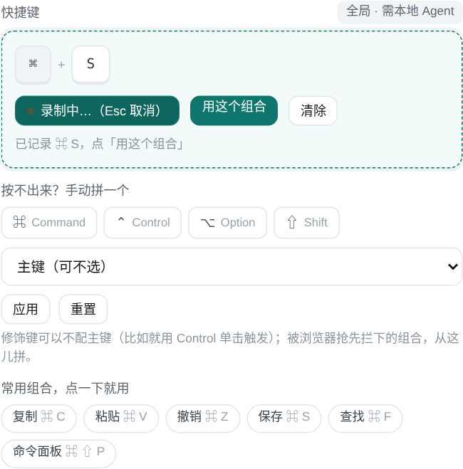
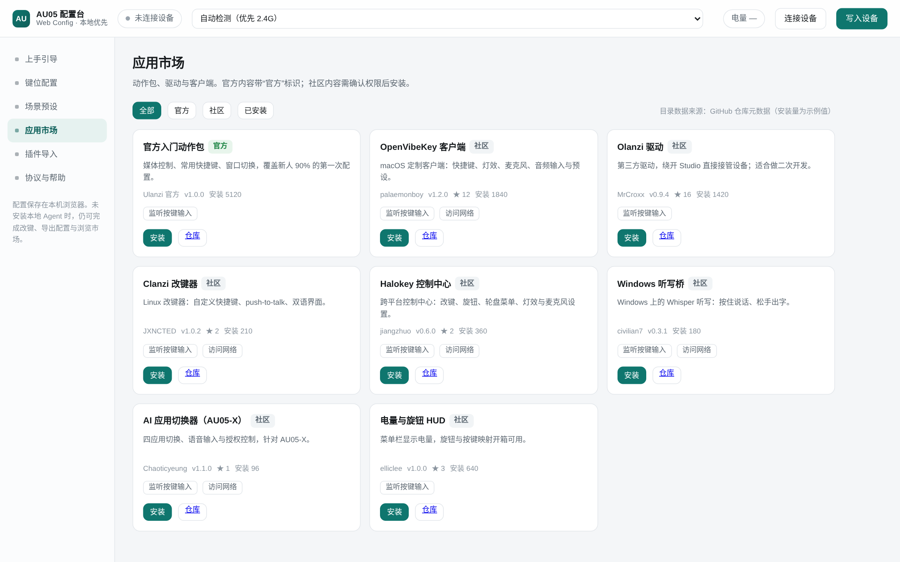

# AU05 配置台（Web Config）

给 Ulanzi **AU05 / VibeKey**（三键 + 一旋钮无线小键盘）做的网页配置台。面向第一次上手的用户：连上设备 → 配三个键和旋钮 → 装预设和插件 → 导出给别人用。

纯前端，单文件 `index.html`，不依赖构建工具和外部 CDN，双击就能跑。配置存在浏览器本地（`localStorage`），可导出 `au05-config.json`。

## 现在能做什么

- **连接与通道**：自动检测 / 仅蓝牙 / 仅 2.4G 接收器三档；自动检测时优先接收器（延时最低）。所选单一模式失效后回到自动检测。
- **键位配置**：3 键 × 单击 / 双击 / 长按，旋钮 × 左旋 / 右旋 / 按压 / 按压+旋转，共 12 个输入位。点设备图选中热区，右侧编辑动作。
- **动作库**：媒体控制、键盘快捷键、文本片段、打开网址、打开应用、切换场景、AI 指令、插件动作。
- **快捷键录制**：录制时实时显示键帽（⌘ ⇧ ?）；修饰键可以累加、主键可以随时替换，确认后点「用这个组合」；Esc 取消、Backspace 清空；系统占用组合（⌘⇧4 截图、⌘Tab 切应用）当场标红并拦住保存；附常用组合一键套用。
- **单独修饰键也能绑**：按住 Control 不配主键，点「只绑这个修饰键」，就能把 Control 单击做成按住说话之类的触发键（会提示占用风险）。
- **手动拼组合**：勾 ⌘ / ⌃ / ⌥ / ⇧ + 主键下拉，把浏览器抢先拦截（⌘W、⌘T 等）的组合也设得进去。
- **冲突检查**：系统保留组合（`cmd+tab`、`cmd+q`、`win+l` 等）标红拒绝；同一动作重复绑定会给出提示。
- **场景预设**：内置编程 / 剪辑 / 会议三套，可一键应用；可把当前配置存成自己的场景、导出、导入。
- **应用市场**：8 个条目（官方动作包 + 社区驱动/客户端），安装前弹权限清单，支持卸载。条目元数据取自 GitHub 仓库，安装量为示例值。
- **插件导入**：插件包 JSON、文件、链接、粘贴四种入口；校验 `id/name/version/permissions`，权限只允许 `input/clipboard/network/filesystem`。
- **真实写入设备**：WebHID 连接厂商通道（usage page `0xFFFC`），按 Studio 同款报文写入——report ID `0x55` + TEA 加密 + 64 字节明文，写 6 个设备槽位后逐槽读回校验；失败只影响该槽位，不会动其他配置。
- **读设备键表 / 电量**：一键读出设备里现存的 6 个槽位（键码），电量走 `01 01 02 01` 查询 + 广播解析，不再是估算值。
- **本地 Agent 桥**：`http://127.0.0.1:17890`，只在回环地址。网页会显示在线状态。

## 快速开始

```bash
# 方式一：直接打开
open index.html          # macOS
start index.html         # Windows

# 方式二：本地起个静态服务（推荐，WebHID 在 file:// 下行为不一致）
python3 -m http.server 8787
# 然后访问 http://127.0.0.1:8787/index.html
```

可选：起本地 Agent（Node ≥ 18，无第三方依赖）

```bash
node agent/server.js
# AU05 agent listening on http://127.0.0.1:17890
```

## 为什么需要本地 Agent

浏览器的边界很硬：

| 能力 | 纯网页 | 本地 Agent |
| --- | --- | --- |
| 读 HID 报文、识别按键 | 可以（Chrome / Edge） | 可以 |
| 写配置到设备 | 可以（厂商通道，6 个槽位，写后读回） | 可以（宿主动作） |
| 任意应用内触发快捷键 | 不行 | 可以 |
| 后台常驻 / 开机自启 | 不行 | 可以 |
| 识别前台应用、按场景切映射 | 不行 | 可以 |

所以这一版的分工是：**网页负责界面、预设、市场、导入导出；Agent 负责系统级能力**。没装 Agent 也能完成配置和市场浏览，只是快捷键不会真的在别的应用里触发。

## 界面

键位配置：点设备正视图上的键位，右侧直接编辑。快捷键用录制模式，实时显示键帽。



快捷键录制：修饰键累加、主键可替换，确认后点「用这个组合」；只按修饰键也能单独绑定。



应用市场：官方与社区内容分开标识，安装前弹权限清单。



## 目录

```
.
├── index.html              # 全部界面与逻辑（单文件，无构建）
├── agent/
│   ├── server.js           # 极简本地 Agent（health / apply / bindings）
│   └── README.md
├── presets/                # 三套内置场景的可导入版本
│   ├── coding.json
│   ├── editing.json
│   └── meeting.json
├── plugins/                # 插件清单示例
│   ├── official-starter.json
│   └── community-sample.json
├── docs/
│   ├── agent-protocol.md   # 网页 ↔ Agent 协议
│   ├── plugin-manifest.md  # 插件清单字段定义
│   └── keys.png            # 界面截图
└── README.md
```

## 数据模型

```json
{
  "schema": "au05.web/1",
  "device": { "model": "AU05", "mode": "auto" },
  "bindings": {
    "key1.click": { "type": "media", "value": "play" },
    "knob.cw":    { "type": "media", "value": "volup" }
  }
}
```

输入标识 = `键位.手势`：

- 键位：`key1` / `key2` / `key3` / `knob`
- 手势：键位为 `click` / `double` / `long`；旋钮为 `ccw` / `cw` / `press` / `pressTurn`

动作类型：`media` / `hotkey` / `text` / `url` / `app` / `preset` / `ai` / `plugin`。

## 插件清单

```json
{
  "id": "my-action-pack",
  "name": "我的动作包",
  "version": "1.0.0",
  "author": "alex",
  "permissions": ["input", "clipboard"],
  "actions": [{ "id": "ai.prompt", "name": "发 Prompt" }]
}
```

字段与校验规则见 [`docs/plugin-manifest.md`](docs/plugin-manifest.md)。

## 范围与已知限制

- **MVP 只承诺 macOS**；Windows 进第二阶段，Linux 为实验性支持。
- 设备通道识别依赖固件 HID 描述符，不同固件报文长度可能不同；页面只做展示与透传，不解析语义。
- 纯网页写入只覆盖设备原生的 6 个键槽；双击/长按/按压+旋转与文本、应用类动作依赖 Agent，设备不保存。
- 无账号体系：以本地设备为身份，不做云同步。
- 市场内容由官方审核；本仓库里的市场列表是**目录示例**，不代表已完成上架审核。

## 路线图

| 阶段 | 内容 |
| --- | --- |
| V1（当前） | 网页配置台 + 预设 + 市场浏览/安装 + 插件导入 + 导出 |
| V2 | 本地 Agent 全量能力（全局热键、场景切换、OTA） |
| V3 | 官方审核后台、分成结算、插件签名 |

## 真实写入设备的边界

写入走的是 Studio 用的厂商通道，协议细节见 [`docs/device-protocol.md`](docs/device-protocol.md)。

- 设备只有 **6 个键槽**（键 1/2/3、旋钮按下、左右旋转），每槽最多 4 个键码；双击、长按、按压+旋转设备不存，由 Agent 做宿主手势。
- 能下发的动作：键盘快捷键（≤4 键）、媒体键。文本、打开网址/应用、切换场景、AI 指令、插件动作都需要 Agent 执行。
- 每次写入都读回比对，一致才算成功；界面会分「已写入 / 需 Agent / 失败」三类逐行显示。

协议常量与自检向量来自开源项目 **halokey**（`crates/proto`）与 **olanzi** 的真机日志：`TEA_Enc(00×8) == 38 90 c4 99 a3 60 aa ad`，实现时逐字节校验过。

## 快捷键录入的设计参考

录制的交互参考了几个已开源的 AU05 客户端：

- **Olanzi**（`MrCroxx/olanzi`）：VIA 风格的键位图 + 键位库（可按名字搜索）+ 直接录制，操作先改草稿、确认再保存。
- **HaloKey**（`jiangzhuo/halokey`）：网页设置页里的组合键盘录制器，修饰键累加、主键替换，另配"勾修饰键 + 主键下拉"的手动通道，Esc 清空。
- **Open VibeKey**（`palaemonboy/OpenVibeKey`）：设置窗 + 菜单栏双入口，按键/旋钮映射与 Profiles 分离；并明确"写入设备的普通快捷键退出 App 仍生效"。

这里沿用了「录制 + 手动拼」两条路：录制解决顺手，手拼兜住浏览器拦下的组合与只按修饰键的场景。

## 致谢

接口与交互设计参考了社区里这些 AU05 / VibeKey 项目（2026-09 之后仍有提交）：

`palaemonboy/OpenVibeKey`、`MrCroxx/olanzi`、`JXNCTED/clanzi`、`jiangzhuo/halokey`、`civilian7/UlanzeAgent`、`elliclee/ulanzi-au05-keys`、`Chaoticyeung/vibekey-ai-switcher`、`OmiroAI/ulanzi-vibekey`、`FjkFjk314/ulanzi-vibe-key`。

## License

MIT
